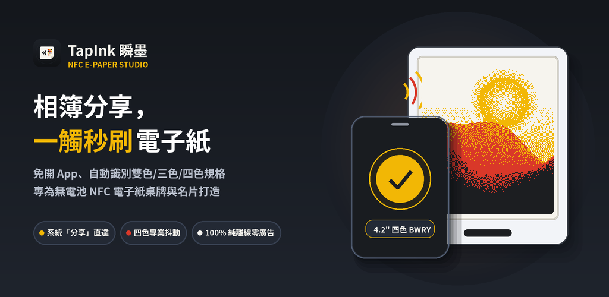
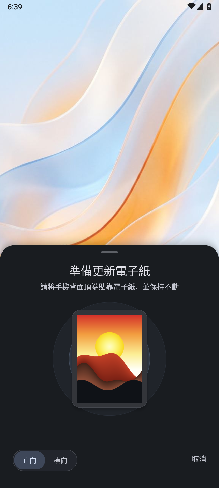
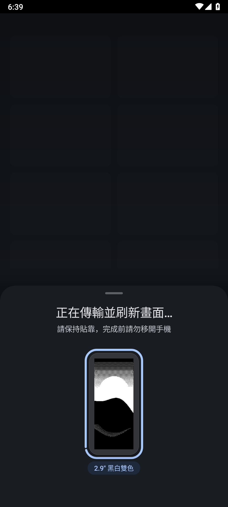
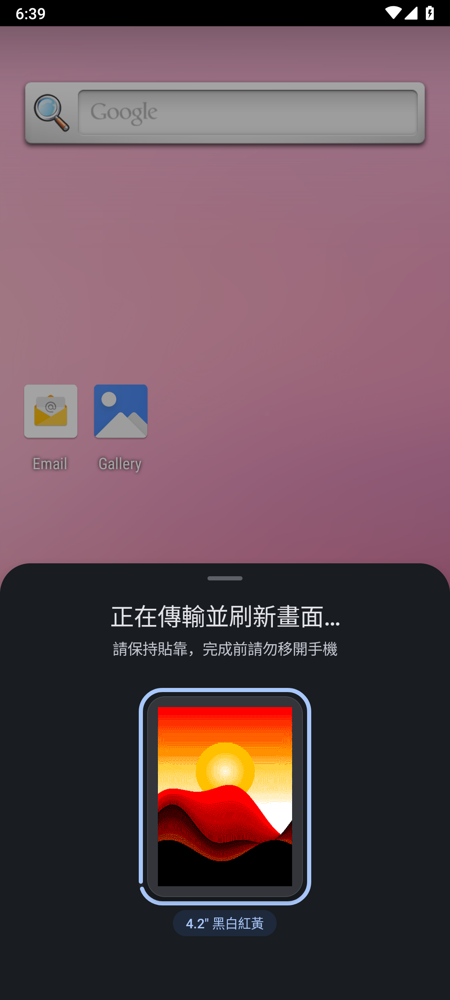
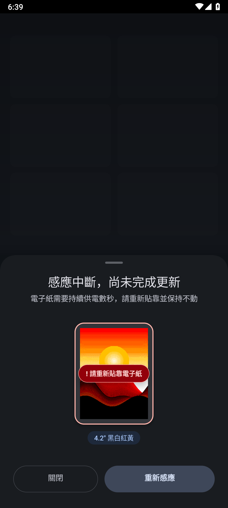

<div align="center">


# TapInk 瞬墨

[繁體中文](README.md) | English | [日本語](README.ja.md)

**Share from your gallery and tap to update.**  
**Bring crisp colors and sharp details to battery-free NFC E-Paper displays with zero manual setup.**

*Update battery-free NFC E-Paper displays directly from Android's share sheet—100% offline.*

[-0B57D0?style=for-the-badge&logo=android&logoColor=white)](https://github.com/dabendan2/tapink/releases/latest/download/tapink-release.apk)
[](https://apps.obtainium.imranr.dev/redirect?r=obtainium://add/https://github.com/dabendan2/tapink)

[](https://github.com/dabendan2/tapink/releases/latest)
[](#download--install)
[](docs/privacy-policy.md)
[](LICENSE)

</div>

---

Battery-free NFC E-Paper displays (such as smart badges, meeting room desk signs, digital business cards, and luggage tags) hold their image indefinitely without charging. **TapInk** integrates E-Paper updates directly into the Android Share Sheet: pick an image, tap Share, and hold the back of your phone against the E-Paper tag to refresh the screen in seconds.

The moment your phone connects, TapInk automatically detects the panel dimensions and color palette, optimizing portrait gradients, text, and QR code sharpness for reflective electronic ink. All image processing happens locally on your device—no manual setup and no internet connection required.

<div align="center">
  
</div>

---

## Download & Install

**[Download Android APK (`tapink-release.apk`, 840 KB)](https://github.com/dabendan2/tapink/releases/latest/download/tapink-release.apk)**  
Supports NFC-enabled devices running Android 7.0 through Android 15+. Open the downloaded file to install.

### How to Use
1. **Choose Your Image**: Prepare an image in Google Photos, Canva, or any photo app, then tap system **"Share ➔ Beam to E-Paper (TapInk)"** (or open `TapInk NFC` directly from your home screen to pick an image).
2. **Tap & Hold Steady**: Hold the **NFC antenna area on the back of your phone** flat against the center of the E-Paper display. Once progress reaches 100% and the panel finishes refreshing, the sheet closes automatically.
3. **Demo Mode**: If you don't have a physical E-Paper tag on hand, open TapInk and **long-press the center preview card for 1 second** to launch the built-in Demo Mode and preview the workflow.

> **Privacy & Permissions**  
> TapInk requests only a single NFC hardware permission (`android.permission.NFC`) and **zero internet permissions**. Your photos, business cards, and barcodes are converted in local memory and written directly to the E-Paper display—never uploaded to any server, with no ads, analytics tracking, or background services.

---

## Screenshots

| 1. Ready to Scan & Live Preview | 2. Fast 2-Color BW Refresh | 3. 4-Color E-Ink Dithering | 4. Disconnect Guard & In-Place Retry |
| :---: | :---: | :---: | :---: |
|  |  |  |  |

---

## Key Features

| Aspect | Traditional Update Workflow | **TapInk Design** |
| :--- | :--- | :--- |
| **Workflow** | Open dedicated app ➔ Import image ➔ Manually select model ➔ Crop ➔ Send | **Android Share Sheet Integration**: Share directly from any image app, tap to transfer, and automatically return to your previous screen |
| **Hardware Detection** | Manually look up and select screen size and color mode from a model list | **Automatic Spec Detection**: Instantly reads screen size, resolution, and color configuration (2-Color / 3-Color / 4-Color / 6-Color) upon contact |
| **Image Processing** | Simple thresholding distorts skin tones and blurs text or barcode edges | **E-Ink Tuned Dithering Algorithm**: Balances portrait skin tone gradients while keeping typography and QR code edges crisp |
| **Transfer Reliability** | Slight movement during scanning requires restarting the whole process | **Reinforced Link & Seamless Retry**: Optimized NFC power harvesting timing for Android 15; simply hold your phone against the tag again to resume in place if interrupted |
| **Privacy & Footprint** | Often requests network access or unnecessary storage permissions | **100% Offline Operation**: Compact 840 KB install size, zero internet permissions, releases system resources immediately after use |

---

## Supported Hardware

TapInk supports passive NFC-powered E-Paper displays, smart badges, desk signs, and luggage tags (including **Santek EZ Sign** series and compatible battery-free NFC E-Paper tags):

| Screen Size | Native Resolution | Supported Color Modes | Typical Use Cases |
| :--- | :--- | :--- | :--- |
| **1.54"** | 200 × 200 | 2-Color BW / 3-Color BWR / 4-Color BWRY | Square key tags, mini badges, asset labels |
| **2.13"** | 250 × 122 | 2-Color BW / 3-Color BWR / 4-Color BWRY | Luggage tags, small price tags, everyday carry tags |
| **2.66" / 2.66" HD** | 296 × 152 / 360 × 184 | 2-Color BW / 4-Color BWRY | Business card holders, shelf labels, locker signs |
| **2.9" / 2.9" HD** | 296 × 128 / 384 × 168 | 2-Color BW / 3-Color BWR / 4-Color BWRY | **Smart ID badges, digital business cards, staff passes** |
| **3.0" / 3.7"** | 400 × 168 / 416 × 240 | 2-Color BW / 3-Color BWR / 4-Color BWRY | Large badge cards, wide desk signs, door plates |
| **3.6"** | 600 × 400 | 6-Color Full Color (Spectra 6) | Color photo frames, display stands |
| **4.2"** | 400 × 300 | 2-Color BW / 3-Color BWR / 4-Color BWRY | **Meeting room signs, seat cards, tabletop stands** |

*Built-in multi-language UI: Automatically adapts to Traditional Chinese (Taiwan / Hong Kong), English, Japanese, Korean, German, French, Spanish, and Simplified Chinese based on system locale.*

---

## Verification & Build

<details>
<summary><b>Expand to view: APK SHA-256 Checksum, Build Environment & Test Commands</b></summary>
<br />

### Release APK SHA-256 Checksum (`v0.9.0`)
Verify the integrity of [`tapink-release.apk`](https://github.com/dabendan2/tapink/releases/latest/download/tapink-release.apk) using the SHA-256 hash below (also recorded in `SHA256SUMS.txt` on the Releases page):
```text
813ad0969c00f9b42fcc652dec21a9c678e7fe09c74428a2bc31c2cf4121bf05  tapink-release.apk
```

### Build & Test from Source
This project is a native Android application (`android/app`) with JVM unit tests and Android emulator end-to-end (E2E) tests.

- **Requirements**: JDK 17+, Android SDK (API 35 / Build-Tools `35.0.0`), Kotlin Compiler (`kotlinc`)

```bash
# Run full build and unit tests (APK/AAB compilation + JVM unit tests + Bundletool validation)
npm test

# Run Android emulator end-to-end (E2E) tests and screenshot verification
npm run test:e2e

# Install onto a connected physical Android device
npm run deploy:device
```

</details>

---

## Legal & Privacy

- **Privacy Policy**: [Privacy Policy (`docs/privacy-policy.md`)](docs/privacy-policy.md)
- **Trademark Disclaimer**: TapInk is an independently developed application and is not affiliated with, authorized by, or endorsed by Santek, EZ Sign, or any other hardware manufacturer. Brand names mentioned are used solely to indicate hardware compatibility.
- **Open Source License**: [MIT License](LICENSE)
