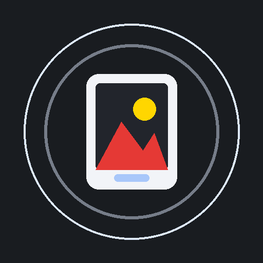
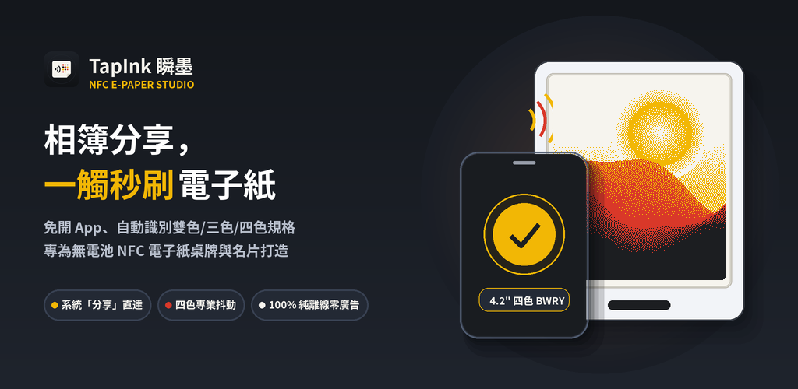
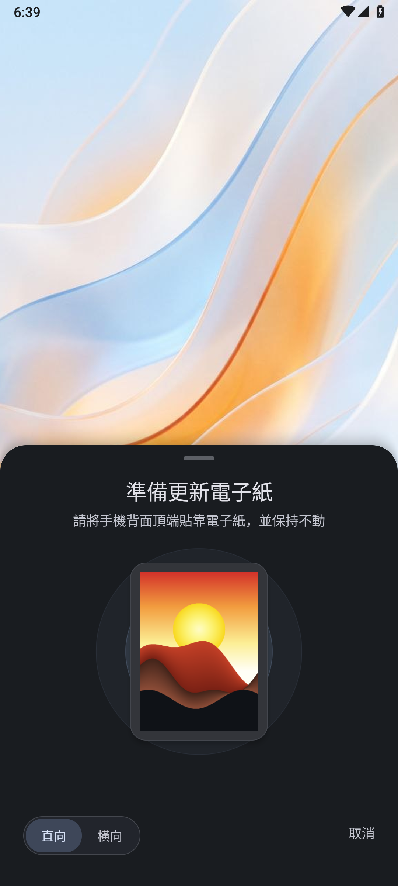
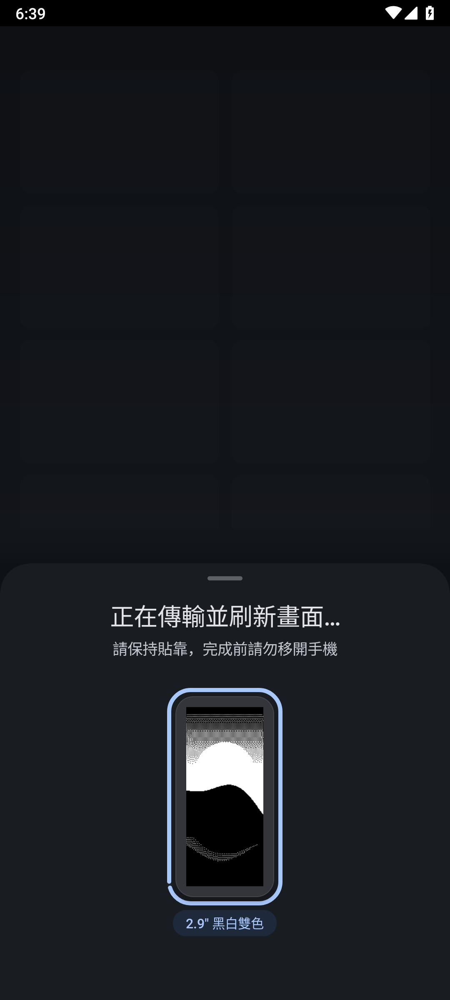
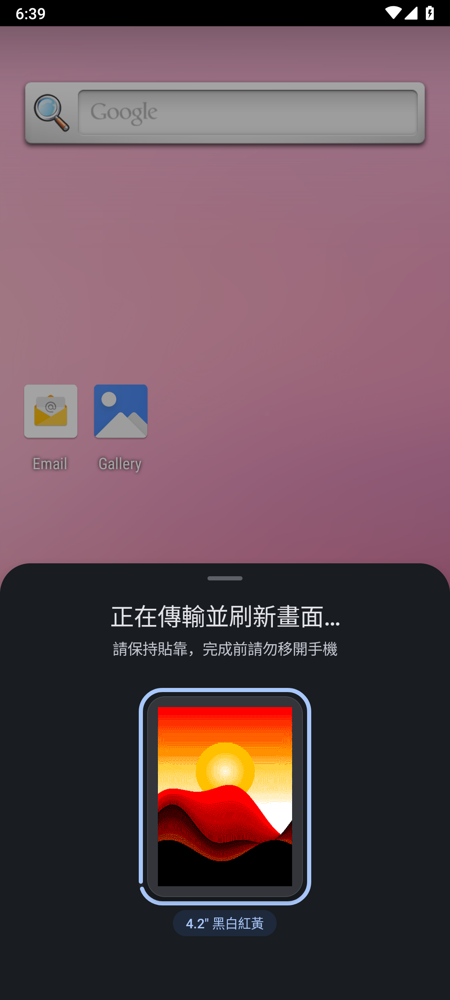
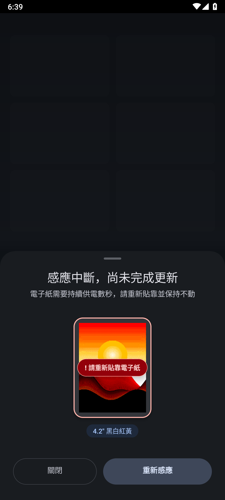

<div align="center">



# TapInk 瞬墨

[繁體中文](README.md) | [English](README.en.md) | 日本語

**ギャラリーから「共有」を選び、スマートフォンをかざすだけで更新完了。**  
**事前設定なしで、電池レス NFC 電子ペーパーに鮮明な色彩とディテールを表示します。**

*Update battery-free NFC E-Paper displays directly from Android's share sheet—100% offline.*

[-0B57D0?style=for-the-badge&logo=android&logoColor=white)](https://github.com/dabendan2/tapink/releases/latest/download/tapink-release.apk)
[](https://apps.obtainium.imranr.dev/redirect?r=obtainium://add/https://github.com/dabendan2/tapink)

[](https://github.com/dabendan2/tapink/releases/latest)
[](#ダウンロードとインストール-download--install)
[](docs/privacy-policy.md)
[](LICENSE)

</div>

---

電池不要の NFC 電子ペーパー（スマート名札、会議室プレート、デジタル名刺、ラゲッジタグなど）は、充電なしで長期間画面を保持できます。**TapInk（タップインク / 瞬墨）** は電子ペーパーの更新フローを Android のシステム共有メニューに統合。画像を選び、共有をタップしてスマートフォン背面を電子ペーパーにかざすだけで、数秒で画面を書き換えます。

かざした瞬間にパネルのサイズとカラー仕様を自動認識し、反射型電子インクの特性に合わせて人物のグラデーションや文字、QRコードの鮮明さを最適化します。すべての画像処理はスマートフォン端末内で完結し、事前設定やインターネット通信は一切不要です。

<div align="center">
  
</div>

---

## ダウンロードとインストール (Download & Install)

**[Android APK をダウンロード (`tapink-release.apk`, 840 KB)](https://github.com/dabendan2/tapink/releases/latest/download/tapink-release.apk)**  
NFC 機能を搭載した Android 7.0 〜 Android 15+ 端末に対応しています。ダウンロードしたファイルを開くとインストールできます。

### 使い方
1. **画像を選択**：Google フォト、Canva、または任意の画像アプリで画面を用意し、システムの **「共有 ➔ 電子ペーパーへ転送 (TapInk)」** を選択します（ホーム画面から `TapInk 電子ペーパー` を直接開いて画像を選ぶことも可能です）。
2. **かざしてタッチ**：**スマートフォン背面の NFC アンテナ部**を電子ペーパーの中央に密着させて静止します。進捗が 100% に達しパネルのリフレッシュが完了すると、シートは自動的に閉じます。
3. **デモモード**：手元に実機の電子ペーパーがない場合でも、TapInk のメイン画面で**中央のプレビューカードを 1 秒間長押し**すると、内蔵のデモモード（Demo Mode）で操作フローを確認できます。

> **プライバシーと権限について**  
> TapInk が要求する権限は NFC ハードウェア制御（`android.permission.NFC`）のみで、**インターネット通信権限は一切要求しません**。写真、名刺、バーコードはすべて端末内で変換され電子ペーパーへ直接書き込まれます。外部サーバーへの送信はなく、広告、トラッキング、バックグラウンド常駐プログラムも一切ありません。

---

## 画面プレビュー (Screenshots)

| 1. スキャン準備とリアルタイムプレビュー | 2. 白黒2色高速リフレッシュ | 3. 4色電子インク・カラーディザリング | 4. 通信中断保護と再試行 |
| :---: | :---: | :---: | :---: |
|  |  |  |  |

---

## 主な機能と設計 (Key Features)

| 機能項目 | 従来の更新フロー | **TapInk の設計** |
| :--- | :--- | :--- |
| **操作フロー** | 専用アプリを起動 ➔ 画像読込 ➔ 型番を手動選択 ➔ トリミング ➔ 送信 | **Android システム共有（Share Sheet）対応**：あらゆる画像アプリから直接共有してかざすだけで転送、完了後は元の画面へ自動復帰 |
| **ハードウェア認識** | 型番リストから画面サイズとカラーモードを手動で指定 | **仕様の自動認識**：かざした瞬間に画面サイズ、解像度、カラー構成（2色 / 3色 / 4色 / 6色）を自動読み取り |
| **画像処理** | 単純な階調変換では肌色が崩れ、文字やバーコードの輪郭がぼやける | **電子インク向けに調整されたディザリング**：人物の肌色や陰影のグラデーションを自然に表現しつつ、文字と QR コードの輪郭をくっきり保持 |
| **転送の安定性** | スキャン中に少しずれると最初からやり直しになる | **接続強化とシームレスな再試行**：Android 15 向けに NFC 給電タイミングを最適化。途中で離れても、もう一度かざすだけでその場から再開 |
| **プライバシーと軽量性** | ネットワーク通信や不要なストレージ権限を要求することが多い | **100% オフライン動作**：アプリサイズわずか 840 KB、通信権限ゼロ、使用後は即座にシステムリソースを解放 |

---

## 対応ハードウェア仕様 (Supported Hardware)

TapInk はパッシブ NFC 給電・通信方式を採用した電子ペーパーディスプレイ、スマート名札、卓上プレート、ラゲッジタグ（**Santek EZ Sign** シリーズおよび互換仕様の電池レス NFC 電子ペーパーを含む）に対応しています：

| 画面サイズ | 解像度 | 対応カラーモード | 主な用途・シーン |
| :--- | :--- | :--- | :--- |
| **1.54"** | 200 × 200 | 白黒2色 / 白黒赤3色 / 白黒赤黄4色 | スクエアタグ、小型バッジ、資産管理ラベル |
| **2.13"** | 250 × 122 | 白黒2色 / 白黒赤3色 / 白黒赤黄4色 | ラゲッジタグ、小型プライスタグ、携帯アクセサリー |
| **2.66" / 2.66" HD** | 296 × 152 / 360 × 184 | 白黒2色 / 白黒赤黄4色 | 名刺ホルダー、棚ラベル、ロッカー表示 |
| **2.9" / 2.9" HD** | 296 × 128 / 384 × 168 | 白黒2色 / 白黒赤3色 / 白黒赤黄4色 | **スマート名札、デジタル名刺、社員証** |
| **3.0" / 3.7"** | 400 × 168 / 416 × 240 | 白黒2色 / 白黒赤3色 / 白黒赤黄4色 | 大型展示カード、横長卓上プレート、ドアプレート |
| **3.6"** | 600 × 400 | 6色フルカラー (Spectra 6) | カラーフォトフレーム、展示スタンド |
| **4.2"** | 400 × 300 | 白黒2色 / 白黒赤3色 / 白黒赤黄4色 | **会議室プレート、席札、卓上スタンド** |

*多言語インターフェース内蔵：システム設定に応じて繁体字中国語（台湾／香港）、英語、日本語、韓国語、ドイツ語、フランス語、スペイン語、簡体字中国語へ自動的に切り替わります。*

---

## 詳細情報：セキュリティ検証とソースコードからのビルド (Verification & Build)

<details>
<summary><b>クリックして展開：APK SHA-256 チェックサム、ビルド環境、テストコマンド</b></summary>
<br />

### リリース APK SHA-256 チェックサム (`v0.9.0`)
以下のハッシュ値を使用して [`tapink-release.apk`](https://github.com/dabendan2/tapink/releases/latest/download/tapink-release.apk) のファイル完全性を検証できます（Releases ページの `SHA256SUMS.txt` にも記録されています）：
```text
40cffc5d9ff5ea2064ad7f097ff241bc0f69cabbf6ed9416d6c2f1fa3e7a36aa  tapink-release.apk
```

### ソースコードからのビルドとテスト
本プロジェクトはネイティブ Android アプリケーション（`android/app`）であり、JVM ユニットテストおよび Android エミュレータ E2E テストを含んでいます。

- **必要環境**：JDK 17+、Android SDK (API 35 / Build-Tools `35.0.0`)、Kotlin コンパイラ (`kotlinc`)

```bash
# フルビルドとユニットテストを実行（APK/AAB コンパイル + JVM ユニットテスト + Bundletool 検証）
npm test

# Android エミュレータ E2E テストとスクリーンショット検証を実行
npm run test:e2e

# 接続された実機 Android 端末へインストール
npm run deploy:device
```

</details>

---

## 関連ドキュメントと免責事項 (Legal & Privacy)

- **プライバシーポリシー**：[Privacy Policy (`docs/privacy-policy.md`)](docs/privacy-policy.md)
- **商標に関する免責事項**：TapInk は独立して開発されたアプリケーションであり、Santek、EZ Sign、またはその他のハードウェアメーカーとは提携・公式認可関係にありません。記載されているブランド名はハードウェアの互換性を説明する目的でのみ使用されています。
- **オープンソースライセンス**：[MIT License](LICENSE)
