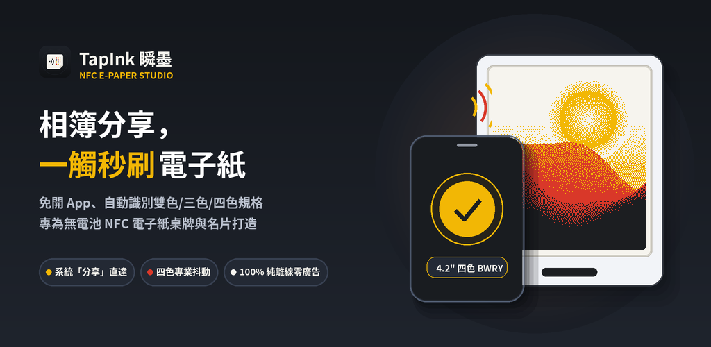
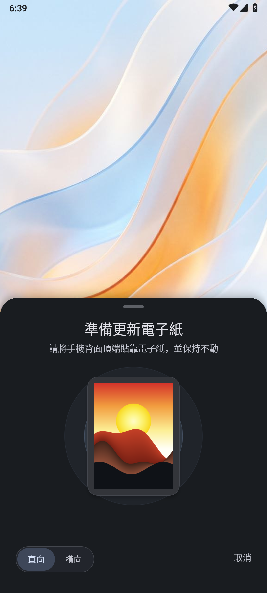
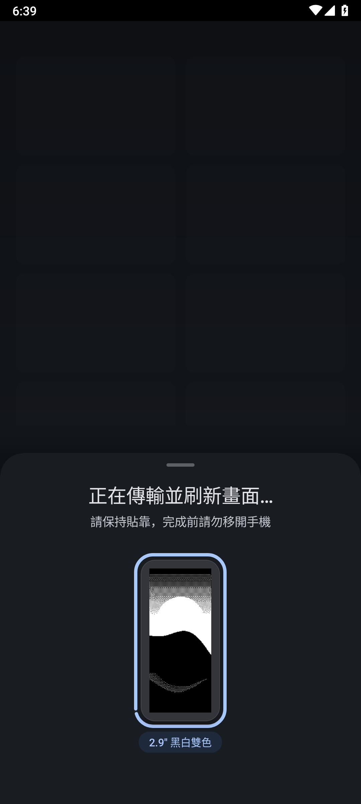
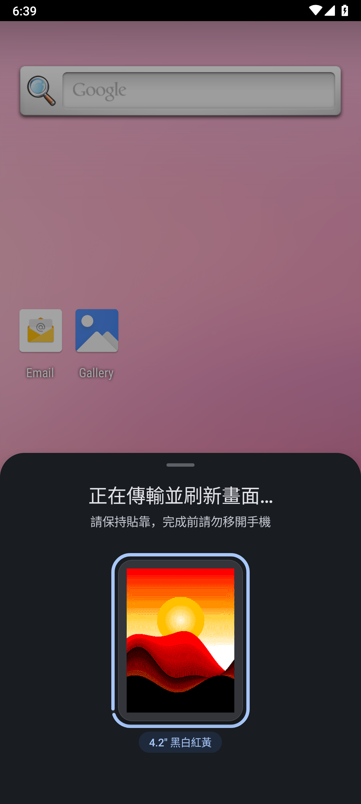
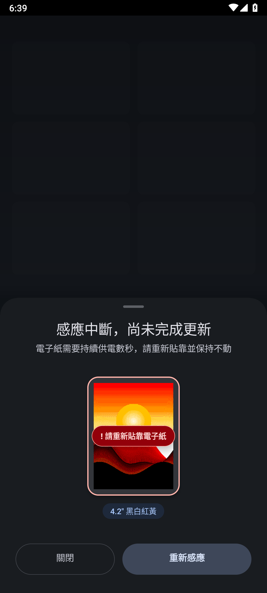

<div align="center">


# TapInk 瞬墨

**一觸瞬墨，隨處分享 — 為無電池 NFC 電子紙打造的極致更新體驗**  
*The effortless, privacy-first Android companion for battery-free NFC E-Paper displays.*

[](https://github.com/dabendan2/tapink/releases/latest)
[-2E7D32?style=flat-square&logo=android&logoColor=white)](https://github.com/dabendan2/tapink/releases/latest/download/tapink-release.apk)
[-0A7EA4?style=flat-square)](#立即下載安裝-download--install)
[](docs/privacy-policy.md)
[](#全球化多語系支援)
[](LICENSE)

</div>

---

**TapInk 瞬墨** 是一款專為 Android 設計的原生無電池 NFC 電子紙（Passive NFC E-Paper / E-Ink）影像更新工具。我們將傳統繁瑣的「開啟專用 App ➔ 猜測螢幕型號 ➔ 手動裁切轉檔」流程，重構為 **「系統分享 ➔ 貼靠感應」的 3 秒直覺反射**。無論是個人攝影珍藏、商務電子名片、會議室智慧桌牌或展場資訊卡，皆能以最佳畫質瞬間定格於電子墨水螢幕之上。

<div align="center">
  
</div>

---

## 📲 立即下載安裝 (Download & Install)

**一般使用者無需下載原始碼或設定開發環境**，請直接在 Android 手機點擊下方連結下載安裝包（`.apk`）即可使用：

- 👉 **[點此直接下載最新 Android 安裝包 (`tapink-release.apk`, ~745 KB)](https://github.com/dabendan2/tapink/releases/latest/download/tapink-release.apk)**  
  *(或前往 [GitHub Releases](https://github.com/dabendan2/tapink/releases/latest) 查看版本更新紀錄與 SHA-256 校驗碼)*
- **系統需求**：Android 7.0 (API 24) 以上，具備 NFC 硬體功能之手機。
- **3 秒快速上手**：安裝後無需特地開啟主程式——直接在 **Google 相簿、Canva、Figma** 或任何 App 點選系統 **「分享 ➔ 刷入電子紙 (TapInk)」**，將手機背面 NFC 感應區貼靠電子紙數秒即可完成更新並自動收起！（亦可在桌面點擊 `TapInk 電子紙` 圖示選圖，或長按中央預覽卡片 1 秒體驗**無硬體展示模式**）。

> 🔒 **零網路權限安全保證**：您可以在手機「應用程式資訊 ➔ 權限」中親自驗證，TapInk **僅宣告單一 `android.permission.NFC` 權限，完全未申請 `INTERNET`（網路連線）或相簿常駐讀取權限**，從系統底層確保您的私人照片與名片絕不外流。首次由瀏覽器安裝時，若系統跳出未知來源或 Play 安全防護提示，請放心點選「允許安裝 / 仍要安裝」。

---

## 畫面預覽

| 1. 準備感應與即時預覽 | 2. 黑白雙色極速刷新 | 3. 四色電子墨水細膩渲染 | 4. 智慧防呆與無縫重試 |
| :---: | :---: | :---: | :---: |
|  |  |  |  |

---

## 四大核心體驗亮點

### ⚡ 1. 系統級「分享即刷」3 秒工作流 (Share-to-Ink Workflow)
無需切換工作脈絡。在 **Google 相簿、Canva、Figma** 或任何設計 App 中準備好畫面，直接點擊系統「分享 (Share)」並選擇 **「刷入電子紙 (TapInk)」**，底部感應面板即刻滑出；貼靠電子紙完成更新後自動收起，行雲流水。

### 🎯 2. 免設定全自動硬體識別 (Zero-Setup Auto-Detection)
告別在冗長清單中盲猜型號的困擾。手機貼靠瞬間，TapInk 自動識別電子紙的螢幕尺寸、解析度與色彩模式（黑白雙色、黑白紅三色、黑白紅黃四色），智慧完成畫面比例裁切與直橫向適配。

### 🎨 3. 博物館級電子墨水色彩渲染 (Studio-Grade E-Ink Rendering)
針對反射式電子墨水顏料光學特性深度調校的色彩擴散引擎。透過微米級的黑、白、紅、黃四色點陣交織，自然還原人像膚色與柔和光影漸層，確保暖白底色純淨不偏黃，同時保留名片文字與 QR Code 的銳利邊緣。

### 🔒 4. 100% 純離線與零連網隱私安全 (Privacy-First & Zero Network)
TapInk **完全不申請網路權限**。所有個人照片、企業識別證、職稱名片與商務 QR Code 均在您的手機本地端記憶體中即時處理並直傳電子紙，零雲端上傳、零廣告、零追蹤器、零背景常駐耗電。

---

## 支援硬體一覽表

TapInk 支援市面上主流採用無源 NFC 供電與通訊之電子紙顯示牌、智慧名片、識別證與行李牌（含 Santek EZ Sign 系列及相容規格之無電池 NFC 電子紙）：

| 螢幕尺寸 | 實體解析度 | 支援色彩模式 | 典型應用場景 |
| :--- | :--- | :--- | :--- |
| **1.54"** | 200 × 200 | 黑白雙色 / 黑白紅三色 / 黑白紅黃四色 | 方形智慧吊牌、迷你徽章、資產標籤 |
| **2.13"** | 250 × 122 | 黑白雙色 / 黑白紅三色 / 黑白紅黃四色 | 輕巧行李牌、小型價格牌、個人配件 |
| **2.66" / 2.66" HD** | 296 × 152 / 360 × 184 | 黑白雙色 / 黑白紅黃四色 | 商務名片夾、展架標籤、儲物櫃標示 |
| **2.9" / 2.9" HD** | 296 × 128 / 384 × 168 | 黑白雙色 / 黑白紅三色 / 黑白紅黃四色 | **主流智慧識別證、數位名片、工作證** |
| **3.0" / 3.6" / 3.7"** | 400 × 168 / 600 × 400 / 416 × 240 | 黑白雙色 / 黑白紅黃四色 / 六色全彩 | 大型隨身展示卡、門牌標示 |
| **4.2"** | 400 × 300 | 黑白雙色 / 黑白紅三色 / 黑白紅黃四色 | **主流會議室桌牌、座位牌、桌上型立牌** |

---

## 全球化多語系支援

原生內建 9 種語言介面，隨 Android 系統語言自動切換：
- **繁體中文**（台灣 `zh-TW` / 香港 `zh-HK`）
- **English** (`en`)
- **日本語** (`ja`)
- **한국어** (`ko`)
- **Deutsch** (`de`)
- **Français** (`fr`)
- **Español** (`es`)
- **简体中文** (`zh-CN`)

---

## 開發者專區：從原始碼建置 (For Developers)

<details>
<summary><b>點擊展開：開發環境需求、建置指令與模擬器 E2E 驗證（一般使用者無需閱讀）</b></summary>
<br />

本專案為純淨原生 Android 客戶端（`android/app`），配備完整的 JVM 單元測試與模擬器端對端（E2E）自動化測試套件。

### 環境需求
- **JDK 17+**
- **Android SDK (API 35)** 與 Build-Tools `35.0.0`
- **Kotlin Compiler (`kotlinc`)**

### 常用建置與驗證指令

```bash
# 執行完整建置與單元測試（Android APK/AAB 編譯 + JVM 9 大單元測試套件 + Bundletool 驗證）
npm test

# 執行 Android 模擬器自動化端對端 (E2E) 驗證與截圖生成
npm run test:e2e

# 安裝至連接的實體 Android 手機
npm run deploy:device
```

### 無硬體展示模式 (Demo Mode for Reviewers)
若在無實體 NFC 電子紙的環境下進行測試或商店審核，只需啟動 App 並**長按中央的電子紙預覽卡片 1 秒**，即可觸發內建的「無硬體展示模式」，完整體驗 4.2 吋四色電子紙的渲染轉換與更新進度動畫。

</details>

---

## 相關文件與法務聲明

- [隱私權政策 (Privacy Policy)](docs/privacy-policy.md)
- **商標聲明**：TapInk 為獨立開發之第三方應用程式，與 Santek、EZ Sign 或其他硬體製造商無官方隸屬或授權關係。文中提及之品牌與名稱僅用於說明硬體相容性。
- **開源授權**：本專案採用 [MIT License](LICENSE) 授權。
